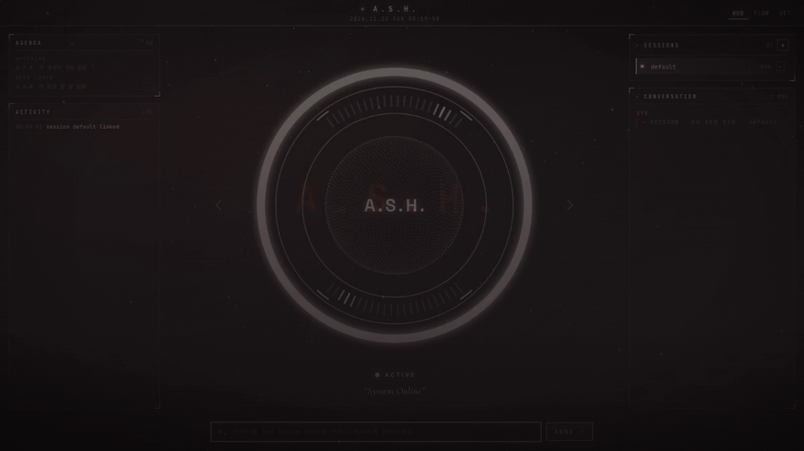

<div align="center">
  <picture>
    <source media="(prefers-color-scheme: dark)" srcset="./assets/logo/logo/ash-horizontal-for-dark-bg.svg" />
    
  </picture>

  <p>여러 AI 에이전트를 한곳에서 운영하는 셀프 호스팅 플랫폼</p>

  <a href="https://ash-hun.github.io/Ash-Industry/">문서</a> |
  <a href="https://github.com/ash-hun/Ash-Industry/releases">데스크톱 앱</a> |
  <a href="./LICENSE">라이선스</a>
</div>

<br />



기본 에이전트 하나에 팀 에이전트를 yaml 파일로 더하고, 브라우저 Web HUD 나 데스크톱 앱에서 대화하고 지켜본다.

- **팀 에이전트**: 에이전트마다 세션, 기억, 도구, 승인 규칙을 따로 갖고 서로 일을 맡긴다
- **멀티프로바이더**: Anthropic, OpenAI, Gemini, Ollama, vLLM
- **장기 기억**: Postgres 에 사용자 프로필, 일화, 절차를 남긴다
- **먼저 말 걸기**: 대화에서 흘린 약속을 기억했다가 때가 되면 먼저 알린다
- **스케줄과 목표**: `/schedule`, `/goal` 로 맡긴 일을 혼자 이어 간다
- **도구와 승인**: 내장 도구, MCP 서버, 확장 패키지. 위험한 도구는 실행 전에 묻는다
- **음성**: 웨이크워드, STT, TTS 로 말로 이어 가는 대화

## 빠른 시작

Docker 와 LLM API 키 하나가 필요하다.

```bash
git clone https://github.com/ash-hun/Ash-Industry.git
cd Ash-Industry
cp .env.example .env              # ASH_LLM__API_KEY 를 채운다
docker compose --profile web up -d
```

http://localhost:7777 을 연다. 포트는 이 컴퓨터(127.0.0.1)에만 열린다. 에이전트가 셸과 파일 쓰기 도구를 가지므로 공개 포트로 열지 않는다. 다른 기기에서는 Tailscale 같은 사설 경로로 들어온다.

<details>
<summary>Docker 없이 실행</summary>

Python 3.11 이상과 [uv](https://docs.astral.sh/uv/) 가 필요하다. Postgres 없이 띄우려면 `.env` 에서 `ASH_MEMORY__BACKEND=in_memory`, `ASH_SESSION__PERSISTENCE_BACKEND=jsonl` 로 바꾼다.

```bash
uv sync --extra web --extra scheduler
uv run ash-industry                  # http://localhost:7777
```

</details>

<details>
<summary>데스크톱 앱(macOS)</summary>

[Releases](https://github.com/ash-hun/Ash-Industry/releases) 에서 `.dmg`(Apple Silicon 은 arm64, Intel 은 x64)를 받는다. 앱은 위 백엔드가 떠 있어야 열린다. 서명이 없어서 처음 한 번 `xattr -dr com.apple.quarantine "/Applications/Ash Industry.app"` 를 실행한다.

</details>

## 모델 고르기

`.env` 에서 프로바이더와 모델을 정한다.

```bash
ASH_LLM__PROVIDER=anthropic          # anthropic | openai | gemini | ollama | vllm
ASH_LLM__MODEL=claude-sonnet-4-5
ASH_LLM__API_KEY=sk-ant-...

# 로컬 모델은 키 없이
ASH_LLM__PROVIDER=ollama
ASH_LLM__BASE_URL=http://localhost:11434
ASH_LLM__MODEL=gemma4:e4b
```

나머지 설정은 [`.env.example`](./.env.example) 과 문서의 [설정 값](https://ash-hun.github.io/Ash-Industry/reference/configuration) 에 있다.

## 내 에이전트 더하기

에이전트, 스킬, 확장은 플랫폼 코드 밖의 프로필 폴더에 둔다. Docker 는 `.env` 의 `ASH_PROFILE_DIR`(기본 `examples/`)를 읽는다. 예시 [`examples/team/scribe.yaml`](./examples/team/scribe.yaml) 을 복사해 시작한다.

```yaml
# <프로필>/team/scribe.yaml  (파일 이름이 에이전트 id)
name: S.C.R.I.B.E.
description: 문서 담당. 회의록과 메모를 정리하고 요약한다
palette: {primary: "#8fd3a8", accent: "#f0b35f"}
system_prompt: |
  당신은 Scribe 입니다. main 과 같은 팀의 문서 담당입니다.
tools: [read_file, write_file, list_dir]
```

백엔드를 재시작하면 HUD 에 나타난다(`docker compose restart ash-backend`). 비운 항목은 기본 에이전트 설정을 따른다. 스킬(슬래시 명령)과 확장 패키지는 문서의 [팀 에이전트 추가하기](https://ash-hun.github.io/Ash-Industry/agents/new-agent) 와 [Extension](https://ash-hun.github.io/Ash-Industry/concepts/extension) 에 있다.

## 더 알아보기

| 문서 | 내용 |
|------|------|
| [설치](https://ash-hun.github.io/Ash-Industry/start/install) | 실행 방법별 준비물 |
| [Web HUD](https://ash-hun.github.io/Ash-Industry/start/web-hud) | 화면 구성과 단축키 |
| [아키텍처](https://ash-hun.github.io/Ash-Industry/concepts/architecture) | 구성 요소와 요청 흐름 |
| [슬래시 명령](https://ash-hun.github.io/Ash-Industry/reference/slash-commands) | `/schedule`, `/goal`, `/remember` 등 |
| [문제 해결](https://ash-hun.github.io/Ash-Industry/troubleshooting) | 먼저 말을 안 걸 때, 승인 창, 음성 |

## 개발

```bash
uv sync
uv run pytest tests/unit
uv run pytest tests/integ            # Postgres 경로는 Docker 가 필요하다
uv run mypy
uv run ruff check src tests
```

Python 을 고친 뒤 `docker compose restart ash-backend` 로 반영된다(`./src` 를 마운트한다).

## 라이선스

Source-available 이며 OSI 오픈소스가 아니다. [PolyForm Noncommercial 1.0.0](./LICENSE) 에 이 소프트웨어와 소스를 머신러닝, AI 모델 학습 데이터로 쓸 수 없다는 조건을 더했다. 비상업 목적이면 쓰고, 고치고, 나눌 수 있다.

Required Notice: Copyright (c) 2026 ash-hun (https://github.com/ash-hun)
