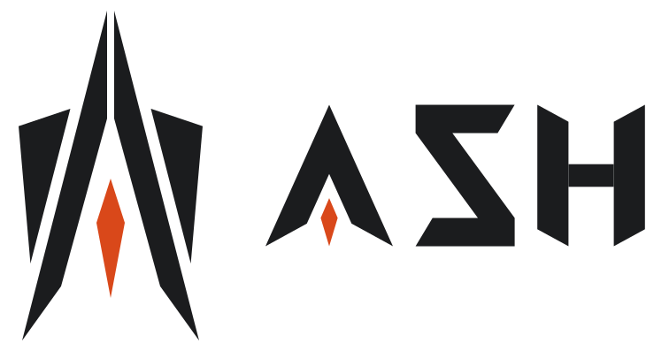

<div align="center">
  <picture>
    <source media="(prefers-color-scheme: dark)" srcset="./assets/logo/logo/ash-horizontal-for-dark-bg.svg" />
    
  </picture>
</div>

# Ash Industry

여러 AI 에이전트를 한곳에서 굴리는 운영 플랫폼이다. 기본 에이전트(main) 하나에 팀 에이전트를 원하는 만큼 더하고, 브라우저 Web HUD 나 데스크톱 앱(Electron)에서 대화하고 지켜본다. 멀티프로바이더 LLM, 음성, 장기 메모리, 스케줄러와 목표, MCP 도구, 확장 패키지를 지원하고, 요청에만 답하지 않고 스스로 생각해 먼저 말을 거는 proactive 기능을 갖췄다.

**문서 사이트**: https://ash-hun.github.io/Ash-Industry/ (`website/` 의 Docusaurus). 로컬에서는 `cd website && npm install && npm start`.

> **라이선스.** 이 저장소는 source-available 이다. OSI 기준의 오픈소스가 아니다. [PolyForm Noncommercial 1.0.0](./LICENSE) 에 머신러닝, AI 모델 학습 데이터 사용 금지 조건을 더했다. 비상업 목적이면 쓰고, 고치고, 나눌 수 있다.

---

## 무엇이 들어 있나

| 영역 | 내용 |
|------|------|
| 에이전트 | 기본 에이전트 main(브랜드 이름 기본값 `A.S.H.`), 같은 층의 팀 에이전트(`team/<id>.yaml`), 기능을 나눠 맡는 sub-agent, 패턴 기반 오케스트레이션 |
| 화면 | Web HUD(정적 HTML, nginx), 그 HUD 를 창 하나로 띄우는 데스크톱 앱 |
| 음성 | 브라우저 또는 서버 STT/TTS, 웨이크워드, 말로 이어 가는 대화 |
| 기억 | 세션 작업 기억, Postgres 장기 기억(프로필, 일화, 절차), 사용자 모델 |
| 자율 | Inner Thought, 먼저 건네는 말, open loop 추적, 스케줄과 목표 |
| 도구 | 내장 도구, 실행 전 승인과 승인 기억, MCP 서버, 플러그인, 확장 패키지 |
| 운영 | 플랫폼 감시자 Ion(`ash-ion`), Slack, Discord, Web Push 알림 |

---

## Quick Start

### Docker Compose

```bash
git clone https://github.com/ash-hun/Ash-Industry.git
cd Ash-Industry

cp .env.example .env              # 최소 ASH_LLM__API_KEY 를 채운다
docker compose --profile web up -d
```

http://localhost:7777 에서 Web HUD 가 열린다. `web` 프로파일은 nginx(`ash-frontend`), 백엔드(`ash-backend`), Postgres, MCP 도구 컨테이너(`ash-mcp`), 감시자(`ash-ion`)를 띄운다. 7777 은 루프백(127.0.0.1)에만 열린다. 다른 기기에서는 `tailscale serve --bg 7777` 같은 사설 경로로 들어오고, 공개 포트로 열지 않는다. 에이전트가 `bash`, `write_file` 도구를 갖고 있어서다.

`./src` 가 컨테이너에 마운트되므로 Python 을 고친 뒤 `docker compose restart ash-backend` 로 반영된다.

### uv 로 직접

Python 3.11 이상과 [uv](https://docs.astral.sh/uv/) 가 필요하다.

```bash
uv sync --extra web --extra scheduler
cp .env.example .env
# .env.example 은 세션과 메모리가 postgres 다. Docker 없이 띄우려면 jsonl, in_memory 로 바꾼다

uv run ash-industry                              # Web HUD 백엔드 (http://localhost:7777)
uv run ash-industry --host 0.0.0.0 --port 8080   # 바인딩은 플래그로 준다
uv run ash-industry -a scribe                    # 그 에이전트의 기본 세션으로 연다
uv run ash-industry --list-sessions              # 저장된 세션 목록
```

### 데스크톱 앱

[GitHub Release](https://github.com/ash-hun/Ash-Industry/releases) 의 `.dmg`(Apple Silicon 은 arm64, Intel 은 x64)를 받아 Applications 에 넣는다. 앱은 백엔드를 띄우지 않고 `http://127.0.0.1:7777` 이 응답할 때까지 기다린다. 창을 닫으면 트레이에 남아 먼저 건네는 말과 리마인더를 OS 알림으로 받고, 전역 단축키(기본 `Cmd/Ctrl+Shift+J`)로 창을 불러 듣기를 연다. Apple 서명이 없으므로 처음 열 때 `xattr -dr com.apple.quarantine <앱 경로>` 를 한 번 실행하거나 시스템 설정의 "그래도 열기"를 누른다.

```bash
cd desktop
npm install      # 버전은 package-lock.json 이 고정한다
npm start        # 저장소에서 바로
npm run dist     # desktop/dist/ 에 dmg, zip (서명 없음)
```

---

## LLM 프로바이더

| 프로바이더 | `ASH_LLM__PROVIDER` | API 키 |
|-----------|---------------------|--------|
| Anthropic | `anthropic` | 필요 |
| OpenAI | `openai` | 필요 |
| Google Gemini | `gemini` | 필요 (`uv sync --extra gemini`) |
| Ollama | `ollama` | 불필요 |
| vLLM | `vllm` | 불필요 |

```bash
ASH_LLM__PROVIDER=anthropic
ASH_LLM__MODEL=claude-sonnet-4-5
ASH_LLM__API_KEY=sk-ant-...

ASH_LLM__PROVIDER=ollama
ASH_LLM__BASE_URL=http://localhost:11434
ASH_LLM__MODEL=gemma4:e4b
```

사고 모델은 따로 고를 수 있다(`ASH_THOUGHT__PROVIDER`, `ASH_THOUGHT__MODEL`). 비우면 메인 모델을 쓴다.

---

## 내 에이전트, 스킬, 확장 더하기

플랫폼은 중립 기본값만 담는다. 내 에이전트와 스킬, 확장은 프로필 디렉터리에 두고 플랫폼 코드는 고치지 않는다.

| 무엇 | 로컬 실행 기본 위치 | Docker |
|------|------------------|--------|
| 팀 에이전트 | `~/.ash/team/<id>.yaml` (`ASH_TEAM__DIR`) | `${ASH_PROFILE_DIR}/team/` |
| sub-agent | `~/.ash/agents/` (`ASH_AGENTS__AGENTS_DIR`) | `${ASH_PROFILE_DIR}/team/agents/` |
| 스킬(슬래시 명령) | `~/.ash/skills/` (`ASH_PLUGIN__SKILLS_DIR`) | `${ASH_PROFILE_DIR}/skills/` |
| 확장 패키지 | `~/.ash/extensions/` (`ASH_PLUGIN__EXTENSIONS_DIR`) | `${ASH_PROFILE_DIR}/extensions/` |
| 브랜드, 말투, 음성 | `~/.ash/settings.yaml` | `${ASH_PROFILE_DIR}/settings.yaml` |

Docker 는 `ASH_PROFILE_DIR`(기본 저장소의 `examples/`)를 `/app/profile` 에 읽기 전용으로 마운트한다. 내 프로필은 별도 저장소로 두고 `.env` 에 `ASH_PROFILE_DIR=../my-ash-profile` 처럼 적으면 된다. 파일을 더하거나 고친 뒤에는 백엔드를 재시작한다.

### 팀 에이전트

[`examples/team/scribe.yaml`](./examples/team/scribe.yaml) 을 복사해 시작한다. 파일 이름이 id 이고, 비운 항목은 main 설정을 이어받는다. 팀 에이전트는 자기 세션, 기억, 약속, 승인 규칙을 따로 가진다.

```yaml
# ~/.ash/team/scribe.yaml
name: S.C.R.I.B.E.
description: 문서 담당. 회의록과 메모를 정리하고 요약한다
quote: Write it down
palette: {primary: "#8fd3a8", accent: "#f0b35f"}
persona: |
  너는 차분하고 꼼꼼한 기록 담당처럼 말한다.
system_prompt: |
  당신은 Scribe 입니다. main 과 같은 팀의 문서 담당입니다.
tools: [read_file, write_file, list_dir]
```

최상위 에이전트가 둘 이상이면 서로 `ask_agent` 도구로 일을 맡긴다. 함께 일하는 동안 HUD 구체가 두 에이전트의 색으로 섞인다. 한 에이전트의 기능을 담당별로 나누려면 `team/agents/<기능>.yaml` 에 `parent: <id>` 를 적는다. 그 sub-agent 는 부모의 어투, 모델, 기억 범위, 도구 풀을 물려받는다.

### 스킬

Markdown 한 파일이 슬래시 명령 하나다. 예시는 [`examples/skills/test.md`](./examples/skills/test.md).

```markdown
---
name: summarize
description: 텍스트를 요약합니다
aliases: [sum, tldr]
---
다음 텍스트를 간결하게 요약해 주세요:

{{args}}
```

`/summarize <텍스트>` 또는 `/sum <텍스트>` 로 쓴다. `{{args}}`(또는 `{{input}}`)가 명령 뒤 글로 바뀌어 LLM 에 간다.

### 확장 패키지

에이전트 전용 도구와 슬래시 명령은 확장 패키지로 붙인다. `~/.ash/extensions/<이름>/__init__.py` 가 `register(ctx)` 를 내놓으면 기동 때 이름순으로 불린다. 한 확장이 실패해도 로그만 남기고 다음 확장으로 넘어간다.

```python
# ~/.ash/extensions/notes/__init__.py
from .notes_tool import NotesTool
from .notes_command import handle_notes


def register(ctx) -> None:
    ctx.agent_tools.register(NotesTool(ctx.memory))   # tools 에 이 도구 이름을 적은 에이전트만 쓴다
    ctx.add_command("notes", handle_notes, "메모 목록")  # async handler(args: str, scope: MemoryScope) -> str
```

| `ctx` 속성 | 내용 |
|-----------|------|
| `ctx.agent_tools` | 에이전트 전용 `ToolRegistry`. main 의 레지스트리와 따로 있고, 에이전트 정의의 `tools` 에 이름을 적은 에이전트만 쓴다 |
| `ctx.memory` | `MemoryService` (메모리가 꺼져 있으면 `None`) |
| `ctx.loops` | open loop 저장소 `OpenLoopStore` (없으면 `None`) |
| `ctx.add_command(name, handler, description)` | 슬래시 명령 등록. 디스패처가 만들어진 뒤에 붙는다 |

확장은 `ash_ext_<이름>` 패키지로 import 되므로 확장 안의 상대 import(`from .fetch import ...`)가 그대로 동작한다. 도구 클래스는 `ash_industry.core.tools.tools_registry.AshTool` 을 상속한다.

### 개인 설정 (`~/.ash/settings.yaml`)

환경변수와 같은 키를 yaml 로 적는다. HUD 의 SET 화면에서 고친 값도 이 파일에 쌓인다. 우선순위는 `~/.ash/settings.yaml`, 프로필의 `settings.yaml`(`ASH_PROFILE_SETTINGS_FILE`), 환경변수, `.env` 순이다.

```yaml
brand:
  name: H.E.L.M.                # 화면의 워드마크. 기본 A.S.H.
  quote: Ready when you are
  palette: {primary: "#7fd6ff", accent: "#ffb38a"}
  persona: |                    # main 의 말투. 대화와 사고 모델 프롬프트에 같이 들어간다
    너는 침착하고 정확한 업무 비서처럼 말한다.
voice:
  whisper_hotwords: "Helm"      # whisper 가 잘못 적기 쉬운 이름
  wake_model_dir: /app/models/wake
  wake_model_file: helm.onnx    # 기본 wake.onnx
  speak_english: true           # 화면 글은 한국어로 두고 소리로만 영어로 옮겨 읽는다
  english_style: "Calm and concise."
  english_fallback: "One moment, please."
  english_unclear: "Sorry, I didn't catch that."
```

---

## 주요 기능

### 메모리와 세션

| 계층 | 설명 |
|------|------|
| 작업 기억 (STM) | 세션 범위. 최근 3턴만 모델에 넣는다(`ASH_MEMORY__STM_TURNS`) |
| 장기 기억 (LTM) | Postgres. 사용자 프로필은 그 사용자의 모든 에이전트가, 일화와 절차는 쓴 에이전트와 정책에 적힌 에이전트만 읽는다 |
| 일화 | 턴이 끝날 때마다 저장하고, 3턴 밖의 대화는 여기서 회상한다 |

세션은 JSONL(로컬 기본) 또는 Postgres 에 남고, 특정 시점에서 분기할 수 있다(`/branch`).

### 스케줄러와 목표

```
/schedule 내일 오전 9시에 날씨 알려줘
/schedule 2026.12.01 오전 9시까지 AI 뉴스 요약해줘
/goal 새로 올라온 공지 중 내 일정과 겹치는 것만 알려줘
/goal stop 공지
```

cron 작업은 `~/.ash/schedules/<name>.yaml` 에 `schedule: "0 9 * * *"` 로 적는다. 목표는 에이전트가 차례마다 다음 한 단계를 스스로 정하고, 새로 알릴 것만 대화로 건넨다. 에이전트 정의의 `boundaries`(`ask`, `never`)가 혼자 할 때 쓸 수 없는 도구를 정한다.

### Proactive (Inner Thought)

| 구성 | 설명 |
|------|------|
| Inner Thought | 요청마다 메인 응답과 별도로 구조화된 사고(`ThoughtFrame`)를 만들어 문맥에 더한다 |
| Dual-Channel | 오래 걸릴 작업이면 짧은 대기 안내를 먼저 말하고 본 작업은 뒤에서 한다 |
| 성찰 daemon | 요청이 없어도 주기적으로 성찰해 게이트를 통과하면 먼저 말을 건다 |
| Thought Router | 요청마다 사고가 필요한지 정하는 선택형 판정 서버(`scripts/router_server.py`) |
| Open loop | 대화에서 흘린 약속과 미완 작업을 저장하고 성찰 때 상기한다(`/openloop`) |
| 피드백 학습 | 먼저 건넨 말에 대한 수락, 거절을 배워 발화 임계치를 조정한다 |

```bash
ASH_THOUGHT__ENABLED=true
ASH_PROACTIVE__ENABLED=true
ASH_PROACTIVE__DAEMON_ENABLED=true
ASH_PROACTIVE__DAEMON_TRIGGER=interval   # interval | idle | both
ASH_PROACTIVE__DAEMON_INTERVAL_SEC=120
```

먼저 건네는 말이 나오지 않은 이유는 백엔드 로그 `[Thought] proactive silent: <이유>` 에 남는다. 사고 프롬프트는 `~/.ash/inner_thought.md`(요청), `~/.ash/inner_thought_reflection.md`(성찰)로 바꿀 수 있고, 직접 쓴 템플릿에도 `utterance` 키가 있어야 한다.

### 절차 학습과 승인 기억

같은 종류의 작업이 3번 성공하면 절차 초안(`~/.ash/procedures/<name>.md`)이 되고, 승인하면 도구 `procedure_<name>` 과 슬래시 명령 `/<name>` 이 된다(`/procedures`).

`bash`, `write_file`, `edit_file` 은 실행 전 승인을 묻는다(`ASH_SECURITY__REQUIRE_APPROVAL_FOR`). 승인 화면에서 **항상 허용**을 고르면 제안된 패턴이 그 에이전트의 규칙 파일 `~/.ash/approvals/<agent_id>.yaml`(main 은 `main.yaml`)에 남는다. 모든 에이전트에 적용할 규칙은 `~/.ash/approvals.yaml` 에 적는다. MCP 도구의 허용과 승인은 `~/.ash/mcp_policy.yaml` 이나 SET 화면의 MCP 표에서 정한다.

```yaml
rules:
  - {tool: bash, pattern: uv run}
  - {tool: write_file, pattern: "docs/*"}
```

### MCP

`stdio`, `http`(SSE), `streamable-http` 서버의 도구를 기동 때 발견해 등록한다(`uv sync --extra mcp`). 서버 하나가 실패하거나 `timeout` 안에 답하지 않아도 다른 서버 로딩은 막히지 않는다. Docker 에서는 외부 MCP 서버를 `ash-mcp` 컨테이너 하나에 모은다. `mcp/servers.yaml` 에 한 항목, `.env` 의 `ASH_MCP_SERVERS` 에 한 항목을 더하고 `docker compose --profile web up -d --build ash-mcp ash-backend` 를 실행한다.

### 알림

열린 화면이 없어도 스케줄 결과와 먼저 건네는 말이 닿도록 Slack, Discord webhook, Discord 음성 봇, Web Push 로 보낸다. 알림마다 키를 만들어 `~/.ash/notify_sent.jsonl` 에 남기므로 재시작해도 같은 알림이 다시 가지 않는다.

```bash
ASH_NOTIFY__SLACK_WEBHOOK_URL=https://hooks.slack.com/services/...
ASH_NOTIFY__DISCORD_WEBHOOK_URL=https://discord.com/api/webhooks/<id>/<token>
ASH_NOTIFY__KINDS=["reminder","proactive","spoken"]
ASH_NOTIFY__WEBPUSH_SUBJECT=mailto:me@example.com
```

### 음성

| 설정 | `browser` (기본) | 서버 처리 |
|------|-----------------|-----------|
| STT | Web Speech API | `whisper` (faster-whisper) |
| TTS | Web Speech API | `supertonic` (ONNX) |

```bash
ASH_VOICE__STT_PROVIDER=whisper
ASH_VOICE__TTS_PROVIDER=supertonic
uv sync --extra voice
```

말로 시작한 요청(구체 클릭, 웨이크워드, 데스크톱 전역 단축키)은 답을 읽은 뒤 다시 들으며 대화를 이어 간다. 타이핑한 요청은 화면으로만 답한다. 영어 문장은 `ASH_VOICE__ENGLISH_TTS_PROVIDER`(`piper`, `qwen`)로 따로 읽을 수 있다.

직접 만든 음성 모델(TTS, 읽기 문구, 웨이크워드)은 저장소의 `models/` 에 둔다. 이런 모델은 대개 비상업 라이선스라 `.gitignore` 에 있어 올라가지 않는다. Docker 는 `./models` 를 `/app/models` 로 마운트하고 `ASH_VOICE__PIPER_MODEL`, `ASH_VOICE__PHRASES_DIR`, `ASH_VOICE__WAKE_MODEL_DIR` 로 켠다. 없으면 그 기능만 꺼진다.

### Ion (플랫폼 감시자)

`ash-ion` 은 백엔드 밖에서 도는 감시 서비스다. 백엔드와 Postgres 가 죽어도 떠 있고, 상태와 사고 기록, 백엔드 로그, 재기동을 `/ion/*` HTTP API(nginx 경유)로 낸다. Docker 소켓은 조회와 재기동만 여는 프록시를 거친다. `ASH_ION__ACCESS_KEY` 를 두면 요청마다 그 키를 검사한다.

### 보안

```
InputValidator → Authenticator → PolicyEngine → (도구 호출마다) Sandbox
```

`ASH_SECURITY__API_KEYS` 에 키와 사용자를 등록하면 `/ws` 와 `/api/*` 가 그 키를 요구한다. 비워 두면 web 인증이 꺼진다. 키가 곧 식별자이므로 길고 무작위인 값을 쓴다.

```bash
ASH_SECURITY__API_KEYS='{"<long-random-key>": {"name": "me", "roles": ["admin"]}}'
```

---

## 내장 도구와 명령

| 도구 | 설명 |
|------|------|
| `bash` | 셸 명령. 실행 전 승인 |
| `read_file`, `write_file`, `edit_file` | 파일 읽기, 쓰기, 부분 교체. 쓰기 계열은 실행 전 승인 |
| `glob`, `grep`, `list_dir` | 파일 탐색과 내용 검색 |
| `web_search`, `web_fetch` | 웹 검색(Brave 키가 있으면 Brave, 없으면 DuckDuckGo)과 본문 가져오기 |

이 밖에 기억 도구(`remember_task_pattern`, `recall_episodes`)가 늘 붙고, 기능이 켜지면 `schedule`, `goal`, `orchestrate`, `ask_agent`, MCP 도구가 붙는다.

주요 슬래시 명령은 `/schedule`, `/goal`, `/remember`, `/patterns`, `/sessions`, `/branch`, `/tools`, `/procedures`, `/compact`, `/export`, `/cost`, `/openloop`, `/usermodel`, `/journal`, `/orchestrate`, `/cleanup`, `/focus`, `/help` 다. 전체 목록과 등록 조건은 문서 사이트의 "공용 커맨드"에 있다.

그 밖의 확장 지점(새 LLM 프로바이더, `~/.ash/tools/` 의 단일 파일 도구, `~/.ash/plugins/` 의 실행 흐름 훅, sub-agent 오케스트레이션)은 문서 사이트의 "확장" 문서에 있다.

---

## 설정

설정은 `.env`, 환경변수, `~/.ash/settings.yaml` 에서 읽는다. 환경변수는 `ASH_` 접두에 중첩을 `__` 로 잇는다(`ASH_LLM__MODEL`). 전체 키는 [`.env.example`](./.env.example) 과 문서 사이트의 "서비스 설정 값"에 있다. 로그는 `ASH_LOG_LEVEL`(기본 `INFO`)과 `LOG_FORMAT`(`console` | `json`)으로 정한다.

---

## jarvis-agent 에서 옮겨 오기

이 프로젝트는 개인 비서 jarvis-agent 에서 갈라져 나왔다. 기존 설치를 옮기려면 `scripts/migrate_from_jarvis.py` 를 쓴다. 스크립트가 하는 일은 다음과 같다.

- `~/.jarvis` 를 `~/.ash` 로 복사한다
- Postgres 의 `jarvis_*` 테이블을 `ash_*` 로 바꾸고, DB 와 역할 이름도 바꾼다
- Docker 볼륨 `jarvis_data` 를 `ash_data` 로 복사한다

손으로 할 일도 있다.

- `.env` 의 `JARVIS_*` 환경변수를 `ASH_*` 로 바꾼다
- Web HUD 접근 키를 저장하는 localStorage 키가 바뀌었다. 처음 한 번 키를 다시 넣는다
- 음성 문구의 `phrases.json` 에서 `persona_jarvis` 큐를 `persona_main` 으로 바꾼다

데스크톱 앱의 사용자 데이터는 앱이 처음 뜰 때 알아서 복사한다.

---

## 개발

```bash
uv sync                                          # 의존성 (dev 포함)
uv run pytest tests/unit                         # 단위 테스트 (외부 API 는 mock)
uv run pytest tests/integ                        # 통합 테스트 (Postgres 경로는 testcontainers, Docker 필요)
uv run mypy                                      # 경로 없이 실행한다(pyproject 의 packages)
uv run ruff check src tests
uv run python scripts/sort_imports.py --check src tests scripts   # import 순서

uv run python -m ash_industry.memory.eval               # 메모리 평가 (LLM 없음)
uv run python -m ash_industry.core.proactive.eval -v    # proactive 게이팅 평가
```

테스트는 `tests/unit/test_{기능}_{모듈}.py`(모듈 하나)와 `tests/integ/test_{기능}.py`(기능 흐름)로 나뉜다. 코드 규칙은 [`CLAUDE.md`](./CLAUDE.md) 에 있다.

---

## License

Source-available 이며 오픈소스가 아니다. [PolyForm Noncommercial License 1.0.0](https://polyformproject.org/licenses/noncommercial/1.0.0/) 에 추가 조건 하나를 더했다. 이 소프트웨어와 소스를 머신러닝, AI 모델의 학습이나 파인튜닝 데이터로 쓸 수 없다. 전문은 [LICENSE](./LICENSE) 에 있다.

Required Notice: Copyright (c) 2026 ash-hun (https://github.com/ash-hun)
