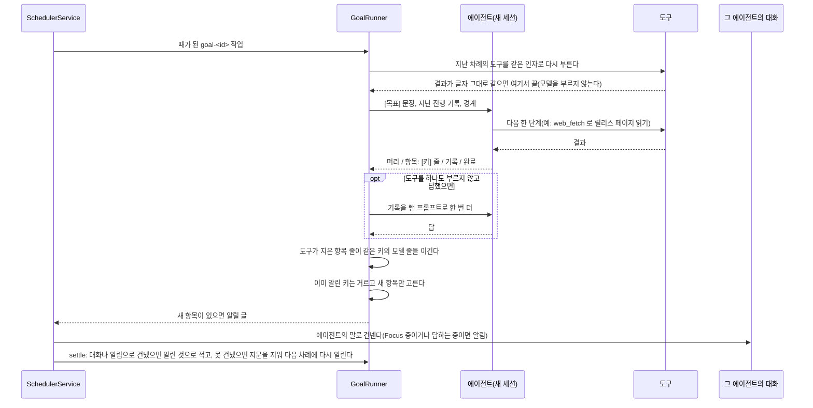

import InfoGoals from '@site/src/figures/info-goals.svg';

# Goals

Goals는 사용자가 에이전트에게 계속 맡겨 두는 일을 다루는 기능이다. 한 번 맡기면 대화가 없는 동안에도 에이전트가 정해진 때마다 한 단계씩 진행하고, 목표가 알리라고 한 것만 대화로 알린다. 차례를 돌리는 시계는 [Scheduling](./scheduling.md) 이 맡고, Goals 는 각 차례에 에이전트가 무엇을 할지 스스로 정하게 하는 쪽을 맡는다.

<figure className="info-fig">
  <InfoGoals />
</figure>

## Goals가 주목한 점

팀 에이전트에게 "새 릴리스가 나오면 바뀐 점만 알려줘" 라고 부탁하는 경우를 생각해 보자. 확인할 대상은 날마다 바뀌는데, 기존의 Chatbot Assistant는 한 번 답하고 나면 그 질문을 잊으므로 사용자는 매일 같은 질문을 다시 해야 한다. 정해진 시각에 같은 작업을 돌리는 예약 기능으로 우회할 수는 있지만, 그러면 같은 소식을 두 번 듣거나 새 소식이 없다는 말을 매시간 듣게 된다. 일정(`/schedule`)이 정한 시각에 정한 일을 하는 것이라면, 목표는 에이전트가 매 차례 무엇을 할지 스스로 정한다. Ash Industry 는 에이전트가 맡은 목표를 스스로 이어 가되, 이미 알린 것을 거르고 결과가 같은 차례를 건너뛰는 일은 모델이 아니라 코드가 맡게 해서, 정말 달라진 것이 있을 때만 사용자에게 말을 건네도록 했다.

### 어떤 기능을 가지고 있나요?

#### 거르기는 모델이 아니라 코드가 한다

- 에이전트는 지금 기준으로 알릴 것을 전부 항목으로 쓰고, 이미 알렸는지는 코드가 키로 가린다. 키가 없는 말("새 소식은 없어요")은 알리지 않는다.
- 대안으로는 이미 알린 키를 모델에게 보여 주고 직접 거르게 하는 방식이 있었다.
- 그렇게 하자 모델이 새 항목까지 빼거나, 저장된 값이 있는데도 그 값을 다시 물었다(3번 중 3번). 키 없는 말을 거르지 않던 때에는 알릴 것이 없을 때 그런 말을 보냈다(3차례 중 2번).

#### 항목 줄은 도구가 짓고 모델은 옮긴다

- 키를 대상의 고유 id 로 두고, 도구 결과에 있는 항목 줄은 모델이 옮겼는지와 상관없이 그대로 받는다. 같은 키면 도구 줄이 이긴다. 묻는 항목(`[ask-<무엇>]`)도 도구가 짓는다.
- 대안으로는 모델이 도구 결과를 읽고 항목 줄과 키를 직접 짓는 방식이 있었다.
- 모델이 같은 대상의 키를 차례마다 다르게 써 같은 항목을 두 번 알렸고, 링크의 쿼리를 잘라 버리거나 도구가 붙인 주의 문구를 빠뜨렸다. 모델이 키를 빼고 말만 써서 7번 중 0번 물은 적도 있다.

#### 결과가 같으면 모델을 부르지 않는다

- 지난 차례에 모델이 부른 도구를 모델 없이 같은 인자로 먼저 부르고, 결과 글의 지문이 같으면 그 차례를 끝낸다.
- 대안으로는 차례마다 모델을 불러 판단을 새로 받는 방식이 있었다.
- 같은 결과면 판단도 같다. 대가로 결과가 바뀐 차례는 도구를 두 번 부르지만, 대상이 바뀌는 날에만 생겨 그대로 둔다.

#### 차례마다 새 세션, 기록은 한 줄

- 차례마다 새 세션을 쓰고 이어 갈 것은 `기록` 한 줄로만 넘긴다. 묻기만 한 차례와 도구 없는 차례의 기록은 남기지 않는다.
- 대안으로는 한 세션에 차례를 이어 붙여 대화 기록을 그대로 쌓는 방식이 있었다.
- 대화 기록이 쌓이면 비용이 는다. 기록 한 줄도 잘못 쌓이면 모델이 도구 결과보다 기록을 믿는다. 라이브 목표에 "값을 몰라" 기록이 세 줄 쌓인 뒤 그 값을 저장했는데, 다음 차례가 도구 결과를 무시하고 다시 물었다.

#### 알린 것은 건넨 뒤에 적는다

- 건넨 뒤에야 항목을 알린 것으로 적는다(`GoalRunner.settle`).
- 대안으로는 항목을 고르는 시점에 알린 것으로 적는 방식이 있었다.
- 고를 때 적으면 건네지 못한 항목은 영영 오지 않는다. 건넨 뒤에 적으면 그 사이 서버가 죽었을 때 같은 항목이 한 번 더 오지만, 놓치는 것보다 낫다고 보았다.

## 세부 동작

### 한 눈에 보기

목표는 `/goal` 로 맡기고, 목록을 보고, 멈춘다.

```text
/goal 새 릴리스가 나오면 바뀐 점만 알려줘   # 지금 세션의 에이전트에게 맡긴다
/goal                                      # 맡은 목표 목록
/goal stop 릴리스                          # 문장 일부로 멈춘다
```



1. 스케줄러가 때가 된 `goal-<id>` 작업을 GoalRunner 에 넘긴다
2. 지난 차례의 도구를 같은 인자로 먼저 불러, 결과가 같으면 모델 없이 끝낸다
3. 결과가 바뀌었으면 새 세션의 에이전트가 목표 문장, 지난 기록, 경계를 받고 한 단계를 진행한다
4. 러너가 항목 줄을 모으고, 이미 알린 키를 거른다
5. 스케줄러가 대화나 알림으로 건넨 뒤 settle 로 알린 것으로 적는다

### 한 차례 규칙

말로 지우기도 된다("그 목표 지워줘"). 지우면 진행 기록과 알린 항목까지 없어진다. 말로도 맡긴다. "~만 알려줘", "~ 나오면 알려줘", "앞으로 ~" 처럼 말하면 에이전트가 `goal` 도구로 맡고 짧게 답한다. 같은 목표를 다시 맡겨도 하나로 남는다. 이런 말이 오면 세션이 그 턴의 시스템 프롬프트 끝(속생각 뒤)에 "계속 챙길 일이면 바로 찾기 전에 goal 로 맡는다" 는 규칙을 붙인다(`goals/tool.py` 의 `standing_rule`). goal 도구가 있는 에이전트에만 붙고, 지금 한 번 묻는 말인지는 모델이 가른다.

- 때: 목표마다 cron 하나. 기본은 매일 9~21시 매시 정각(`0 9-21 * * *`)이다. 맡기면 첫 차례는 바로 돈다
- 세션: 차례마다 새 세션이다. 대화 기록이 쌓여 비용이 늘지 않게, 이어 갈 것은 `기록` 한 줄로만 넘긴다(최근 5줄을 보인다)
- 답의 꼴: 에이전트는 `머리:`(한 문장), `항목: [키] 한 줄`(알릴 것마다), `기록:`, `완료:` 로만 답한다. 머리표를 빼고 `[키] 줄` 만 써도 받는다
- 도구가 지은 항목: 도구 결과에 `항목: [키] 줄` 이 있으면 모델이 옮겼는지와 상관없이 그 줄을 그대로 항목으로 받는다. 같은 키면 도구 줄이 이긴다. 허락이나 값을 구하는 항목의 키는 `ask-` 로 시작하고, 묻기만 할 때는 머리를 붙이지 않는다. 이 항목도 키로 걸러지므로 사용자만 정할 값은 한 번만 묻고, 답을 받아 저장하면 다음 차례부터 이어 간다
- 건너뛰기: 차례가 끝나면 모델이 부른 도구(이름, 인자)와 결과 글의 지문을 목표에 적는다(`last_calls`, `seen`). 다음 차례는 그 도구를 모델 없이 같은 인자로 먼저 부르고, 지문이 같으면 모델을 부르지 않고 끝낸다. 결과가 바뀌었거나, 도구가 오류이거나, 지금 쓸 수 없는 도구이거나, 지난 차례의 항목을 건네지 못했으면 모델이 돈다. 답이 없거나 도구 오류가 난 차례는 지문을 남기지 않는다
- 기록: 도구를 부르지 않은 차례와 묻기만 한 차례의 `기록` 은 남기지 않는다. 도구를 하나도 부르지 않고 답하면 기록을 빼고 한 번 더 돌린다
- 거르기: 에이전트는 지금 기준으로 알릴 것을 전부 항목으로 쓰고, 이미 알렸는지는 코드가 키로 가린다. 키가 없는 항목("새 소식은 없어요")은 알리지 않는다
- 전하기: 그 에이전트와 최근 대화한 세션에 에이전트의 말로 건넨다. 대화 기록에 남아 이어 물을 수 있고, 밖으로는 💭 푸시로 간다. 열린 대화가 없으면(재시작 뒤) 저장된 마지막 대화(스케줄 실행, 위임, 집중, 시험 세션 제외)를 다시 열어 건네고, 그것도 없으면 새 대화를 만든다. 사용자가 답하는 중이거나 집중 중이라 건네지 못하면 스케줄 알림(화면, 푸시, Discord)으로 간다. 대화 전달은 알림 채널이 없어도 간다
- 알린 것으로 적기: 항목은 건넨 뒤에야 알린 것으로 적는다(`GoalRunner.settle`). 대화도 알림도 못 건넸으면 다음 차례에 다시 온다
- 저장: 목표는 `~/.ash/goals/<id>.json`, 차례 작업은 `~/.ash/schedules/goal-<id>.yaml` 이다. id 는 (에이전트, 공백과 대소문자를 정리한 목표 문장)의 해시다

### 경계

에이전트 정의 파일의 `boundaries` 가 스스로 할 때의 경계다. 적지 않은 도구는 혼자 해도 된다.

```yaml
# team/scribe.yaml
boundaries:
  ask: [write_file]   # 스스로 하지 않는다. 필요하면 허락을 구하는 말을 항목으로 쓴다
  never: [bash]       # 어디서도 쓰지 않는다(도구 목록에서 빠진다)
```

| 상황 | `never` | `ask` |
|---|---|---|
| 대화(사용자가 직접 시킨 일) | 안 보인다 | 쓴다. 사용자가 시킨 일은 이미 물은 것으로 본다 |
| 목표 차례 | 안 보인다 | 안 보인다. 프롬프트의 "먼저 물어야 하는 일" 에 적힌다 |
| 스케줄 작업(`kind: task`) | 안 보인다 | 안 보인다 |
| 먼저 해 두기(proactive 자율 행동) | 안 보인다 | 하지 않는다 |

- 목표 차례는 새 목표와 새 일정을 만들지 않는다(`goal`, `schedule` 은 늘 "먼저 물어야 하는 일")
- 도구가 `user_only_params` 로 표시한 인자(돈, 조건처럼 사용자만 정할 값)는 목표 차례에서 버리고 저장된 값으로 돈다. 사용자가 쓴 지시가 있는 스케줄 작업에서는 버리지 않는다. 저장된 값이 없는데 모델이 시스템 프롬프트의 예시 금액을 넣어 계산한 적이 있어서다(18번 중 1번)

### 한계

- 건넨 직후 알린 것으로 적기 전에 서버가 죽으면 다음 차례에 같은 항목이 한 번 더 온다(놓치는 것보다 낫다, `# idempotent` 표시)
- 결과가 바뀌어 모델이 도는 차례는 도구를 두 번 부른다(다시 부르기 한 번, 모델이 한 번). 대상이 바뀌는 날에만 생겨 그대로 둔다
- 목표 차례는 사용자 기억을 읽지 않는다(새 세션, 빈 메모리 체인). 조건은 도구가 읽는 저장소에 있어야 한다
- 말로 맡기기는 모델 판단이다. 확실히 맡기려면 `/goal` 을 쓴다
- 목표를 닫는 것은 사용자뿐이다. 에이전트가 `완료: 예` 로 답하면 목표는 그대로 두고 "그만 챙길까요?" 를 `ask-done` 항목으로 한 번만 묻는다. 그만두려면 목표를 멈춰 달라고 말한다. 예전에는 `완료: 예` 면 바로 닫아, 계속 지켜보라고 맡긴 목표가 한 번 알린 뒤 닫혔다

### 구현 위치

- `core/goals/`: `goals_types.py`(목표, 답 해석, 거르기), `goals_store.py`(파일 저장소), `runner.py`(한 차례, 경계 도구 창), `tool.py`(`goal` 도구)
- `core/slash/goal_cmd.py`(`/goal`), `core/scheduler/scheduler_service.py`(`kind: goal`, 경계), `app/agent_registry.py`(`boundaries`)
- 실험: `scripts/experiments/goal_store.py`

## Performance Experiments

목표 저장소가 목표 수에 따라 얼마나 빠른지 쟀다.

### 저장소

- **질문**: 목표가 늘어도 맡기기와 읽기가 빠른가, 같은 목표를 두 번 맡기면 하나로 남는가
- **설정**: 임시 디렉터리에서 목표 수를 10, 100, 1,000 으로 늘리며 잰다(M4 Pro)
- **결과**:

| 목표 수 | 맡기기 중앙값 | 맡기기 최대 | 하나 읽기 | 목록 | 두 번 맡긴 뒤 수 |
|---|---|---|---|---|---|
| 10 | 0.14ms | 0.23ms | 0.03ms | 0.3ms | 10 |
| 100 | 0.13ms | 0.27ms | 0.02ms | 2.2ms | 100 |
| 1,000 | 0.14ms | 4.0ms | 0.03ms | 21.3ms | 1,000 |

- **해석**: 맡기기와 하나 읽기는 목표 수와 상관없이 1ms 아래다. 목록만 목표 수에 비례한다. 두 번 맡겨도 수가 늘지 않는다
- **한계**: 로컬 파일 시스템 한 환경의 측정이다
- **재현**: `scripts/experiments/goal_store.py`
