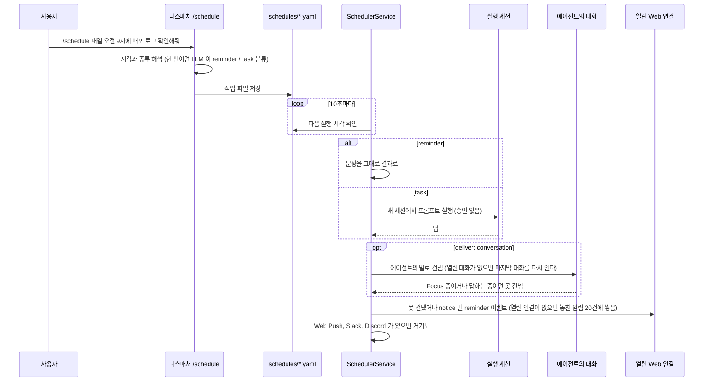
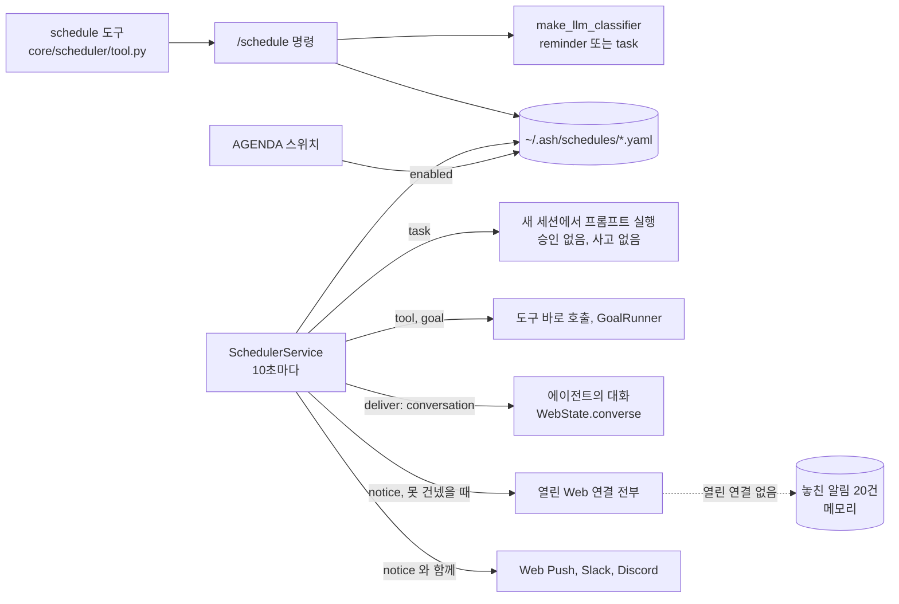

import InfoScheduling from '@site/src/figures/info-scheduling.svg';
import FigureScheduling from '@site/src/figures/scheduling.svg';

# Scheduling

Scheduling은 정한 시각이나 주기에 맞춰 알림과 작업을 대신 돌려 주는 기능이다. 사용자가 화면 앞에 없어도 결과가 대화나 알림으로 닿게 해서 "내일 9시에 알려줘" 같은 부탁을 잊지 않고 지키고, [Goals](./goals.md) 의 차례와 팀 에이전트의 감시 도구처럼 정해진 때에 돌아야 하는 다른 기능의 바탕이 된다.

<figure className="info-fig">
  <InfoScheduling />
</figure>

## Scheduling이 주목한 점

퇴근 전에 "내일 오전 9시에 배포 로그 확인해줘" 라고 말해 두고 노트북을 닫았다고 하자. 기존의 Chatbot Assistant는 다음 날 9시에 화면이 열려 있지 않은 이상 그 부탁을 어디에도 전하지 못한다. 그래서 보통은 캘린더 알람이나 별도의 cron 스크립트를 따로 걸어 두는 식으로 우회하지만, 이렇게 하면 결과를 다시 에이전트와 이어서 이야기할 수 없다. 새 릴리스나 새 공지처럼 하루 중 언제 올라올지 모르는 정보라면, 사람이 페이지를 계속 새로고침하지 않아도 올라오자마자 알 수 있어야 한다. Ash Industry 는 예약한 일을 화면 밖에서도 끝까지 전하고, 그 결과를 대화로 이어 갈 수 있게 했다. 서버가 죽거나 알림이 실패하는 순간에도 같은 알림을 두 번 울리거나 새 소식을 잃지 않도록 처리 순서를 정한 것이 이 기능의 핵심이다.

### 어떤 기능을 가지고 있나요?

#### 한 번 실행 작업은 먼저 내리고 실행한다

- 정한 시각에 한 번 울리는 작업(`run_at`)은 실행하기 전에 목록과 저장 파일에서 먼저 내린다. 서버가 꺼져 있는 동안 지난 작업은 켜지는 즉시 보내고, 얼마나 늦었는지(`delayed_sec`)를 함께 넘긴다.
- 대안으로는 실행을 마친 뒤에 내리는 순서가 있었다.
- 실행 뒤에 내리면 실행 도중 서버가 죽었다가 다시 뜰 때 같은 알림이 두 번 울린다. 먼저 내리면 최악의 경우 한 번도 안 울리지만, 알림을 두 번 받는 것보다 덜 거슬린다고 판단했다.

#### 사용자가 쓴 파일은 지우지 않는다

- 실행이 끝난 작업 파일 중 스케줄러가 만든 것(`<name>.yaml`)은 지우고, 사람이 직접 쓴 파일은 지우지 않고 `enabled: false` 로만 바꾼다.
- 대안으로는 끝난 작업 파일을 만든 쪽과 상관없이 모두 지우는 방식이 있었다.
- 사람이 쓴 파일에는 주석이나 메모가 있을 수 있어서다.

#### 결과는 화면이 없어도 간다

- 결과를 알림 콜백 하나로 모아 열린 화면 전부에 보내고, 열린 화면이 없으면 최근 20건을 쌓아 다음 접속 때 `missed` 로 보낸다. Web Push, Slack, Discord 가 설정돼 있으면 같은 결과가 그쪽으로도 간다.
- 대안으로는 예전처럼 cron 작업의 결과를 그 작업이 돈 세션에만 남기는 방식이 있었다.
- 그 방식에서는 결과가 화면에 오지 않아, 사용자가 예약해 둔 일의 결과를 받지 못했다.

#### 본 것은 건넨 뒤에 적는다

- 감시 도구처럼 "새 것만" 알리는 도구는 `settle(delivered)` 메서드를 가질 수 있다. 스케줄러는 한 번 실행을 마치고 건넸는지(대화나 알림)를 이 메서드로 알려 주고, 도구는 그 뒤에야 새 항목을 본 것으로 적는다. 못 건넸으면 버려 다음 차례에 다시 고른다.
- 대안으로는 도구를 부를 때 새 항목을 바로 본 것으로 적는 방식이 있었다.
- 바로 적으면 알림이 실패한 항목은 다시 오지 않는다. 놓친 항목 비율이 알림 실패율을 그대로 따라가다가, 순서를 바꾼 뒤 0% 가 됐다.

## 세부 동작

### 한 눈에 보기

`/schedule` 로는 한 번과 마감까지 반복 두 가지를 등록하고, cron 주기는 작업 파일에 직접 쓴다. 등록한 작업은 AGENDA 카드에서 켜고 끈다.

```text
/schedule 내일 오전 9시에 배포 로그 확인해줘      # 한 번
/schedule 2026.10.20 오후 6시까지 보고서 초안 작성   # 마감까지 반복
```

<figure className="paper-fig">
  <FigureScheduling />
  <figcaption><b>Figure 1.</b> /schedule 문장(1)은 한 번(…에) 또는 마감까지 반복(…까지)으로 해석되어 작업 파일로 남는다(2). 대화 중에는 schedule 도구가 같은 길로 들어온다. cron 과 tool 작업은 파일에 직접 쓰고, goal 작업은 /goal 이 만든다. SchedulerService 가 10초마다 깨어나(3) 시각이 된 작업을 종류대로 처리한다. reminder 는 문장을 그대로, task 는 승인 없는 새 세션에서 실행한 답을, tool 은 도구 글을, goal 은 목표 한 차례의 결과를 낸다. `deliver: conversation` 이면 그 에이전트의 대화에 에이전트의 말로 건네고(4), 건네지 못하면 알림으로 보낸다. 알림은 열린 Web 연결 전부로 가고, 열린 연결이 없으면 놓친 알림으로 쌓이며, Web Push, Slack, Discord 가 설정돼 있으면 거기로도 간다.</figcaption>
</figure>



1. `/schedule` 이나 `schedule` 도구가 시각과 종류를 해석해 작업 파일을 쓴다
2. SchedulerService 가 10초마다 깨어나 시각이 된 작업을 고른다
3. 종류대로 글을 만든다(reminder 는 문장, task 는 새 세션의 답, tool 은 도구 글, goal 은 목표 한 차례의 결과)
4. `deliver` 대로 대화에 건네거나 알림으로 보낸다
5. 전달 결과를 받는 도구(`settle` 을 가진 도구)와 목표에는 건넸는지를 알려(settle), 건넨 것만 처리한 것으로 적게 한다

### 작업 규칙

- 한 번 실행(`...에`): LLM 분류기에 `reminder`(그 문장을 그대로 알림)인지 `task`(프롬프트를 실행)인지 한 번 묻는다. 분류에 실패하면 reminder 로 둔다
- 마감까지 반복(`...까지`): 남은 시간으로 주기를 고른다. 7일 이상이면 매일 9시, 하루 이상이면 6시간마다, 1시간 이상이면 매시, 그 아래는 10분마다. 마감(`run_until`)이 지나면 스케줄러가 작업을 끄고 작업 파일의 `enabled` 도 `false` 로 바꾼다. 메모리에서만 끄면 재시작 때 다시 켜지기 때문이다
- 말로 예약: 대화에서 "1분 뒤에 알려줘" 라고 하면 에이전트가 `schedule` 도구로 `/schedule` 과 같은 일정을 만든다. 같은 요청을 두 번 하면 알림도 두 개다
- 파일: 작업은 `~/.ash/schedules/<name>.yaml` 에 저장한다. 켜고 끄면 `enabled` 키만 바뀐다. 한 번 실행을 마친 작업은 스케줄러가 파일을 지우거나 `enabled: false` 로 바꾼다
- 실행: 스케줄러는 10초마다 깨어나 새 세션에서 프롬프트를 돌린다. 이 세션은 빈 메모리 체인을 쓰고 사고 엔진이 없다. 서버가 꺼져 있는 동안 지난 한 번 실행 작업은 켜지는 즉시 `delayed_sec` 를 달고 실행된다. cron 작업은 직전 슬롯이 60초 안일 때만 돌므로, 꺼져 있던 동안의 슬롯은 건너뛴다
- 에이전트: 작업 파일의 `agent` 가 main 이 아니면 그 에이전트의 모델, 시스템 프롬프트, 도구(정의의 `tools`)로 돈다. `tools_allowed` 는 그 도구 안에서 다시 고른다
- 도구 작업(`kind: tool`): 프롬프트 없이 `tool` 을 `args` 로 바로 부르고 그 글을 알린다. LLM 을 부르지 않는다. 도구가 빈 글을 주면 알리지 않는다. 파일로만 만든다
- 목표 작업(`kind: goal`): `/goal` 이나 `goal` 도구가 만든다. 그 목표를 한 차례 진행하고 새로 알릴 것이 있을 때만 알린다([Goals](./goals.md))
- 경계: 에이전트 정의의 `boundaries.ask` 도구는 사람이 없는 작업(`task`, `goal`)에서 빠진다. 물을 사람이 없어서다
- 위험 명령: 사람이 없는 작업에도 위험 명령 패턴 검사는 그대로 걸린다. 승인 대상만 비워 두었다. 도구 작업의 호출이 위험 명령으로 보이면 실행하지 않고 알리지도 않는다
- 전하는 곳(`deliver`): `notice`(기본)는 아래 전달 방식대로 스케줄 알림으로, `conversation` 은 그 에이전트의 대화 세션에 에이전트의 말로 건넨다(아래 예)
- 전달: 열린 Web 연결 전부에 `reminder` 이벤트를 보낸다. 아무도 없으면 최근 20건을 쌓아 두었다가 다음 접속 때 `missed: true` 로 보낸다. Web Push, Slack, Discord 가 있으면 거기에도 보낸다. 푸시 제목은 보낸 에이전트의 색 원과 이름이다(예: `🟢 S.C.R.I.B.E.`, 본문은 `⏰ 작업 이름` 다음 줄부터)

:::danger

스케줄 실행 세션은 승인 없는 샌드박스를 쓴다. 스케줄 작업이 부르는 도구는 사람에게 묻지 않고 실행된다.

:::

### 예: 팀 에이전트의 도구로 감시하기

도구 작업은 LLM 없이 도구 하나를 정한 주기로 부른다. 예를 들어 확장 패키지가 `scribe` 에게 받은편지함 요약 도구 `inbox_digest` 를 등록했다면, 평일 근무 시간에 10분마다 부르고 새 것이 있을 때만 scribe 의 말로 건넬 수 있다.

```yaml
# ~/.ash/schedules/inbox-digest.yaml
name: inbox-digest
description: 새 메일 요약(평일 근무 시간 10분마다)
schedule: "*/10 9-18 * * 1-5"
kind: tool
agent: scribe
tool: inbox_digest
args: {quiet: true}
deliver: conversation
prompt: ""
```

도구가 빈 글을 주면 아무것도 보내지 않는다. 도구가 `settle` 을 가졌으면 건넨 뒤에야 본 것으로 적으므로, 알림 채널이 실패해도 다음 차례에 같은 항목을 다시 알린다.

`deliver: conversation` 이면 결과를 스케줄 알림이 아니라 그 에이전트의 말로 건넨다. 사용자가 그 에이전트와 가장 최근에 대화한 세션에 먼저 건네는 말로 들어가 대화 기록에 남으므로, 이어서 "그거 자세히 알려줘" 라고 물을 수 있다. 화면에는 그 에이전트의 말로 보이고, 음성이면 하던 말이 끝난 뒤 읽고, Web Push 로도 간다. 지금 열린 대화가 없으면(재시작 직후 포함) 저장된 마지막 대화를 다시 열어 건네고, 그것도 없으면 새 대화를 만든다. Focus 중이거나 답하는 중이 2분 넘게 이어지면 스케줄 알림(`reminder`)으로 보낸다.

### 한계

:::warning

놓친 알림은 프로세스 메모리에만 쌓인다. 재시작하면 사라진다.

:::

- 한 번 실행 작업은 먼저 내리고 실행하므로, 실행 도중 서버가 죽으면 그 알림은 한 번도 울리지 않을 수 있다
- cron 작업은 서버가 꺼져 있던 동안의 슬롯을 건너뛴다
- 말로 같은 예약을 두 번 하면 알림도 두 개다
- 같은 기록을 쓰는 두 감시 작업이 같은 분에 돌면 같은 항목을 둘 다 새 항목으로 볼 수 있다. 그래서 시각을 나눠 둔다

### 구현 위치

왼쪽이 사용자와 화면, 가운데가 코드 모듈, 오른쪽이 저장소다. 화살표는 호출이나 데이터의 방향이다.



- 핵심 모듈: `core/scheduler/`
- 저장: `~/.ash/schedules/*.yaml`
